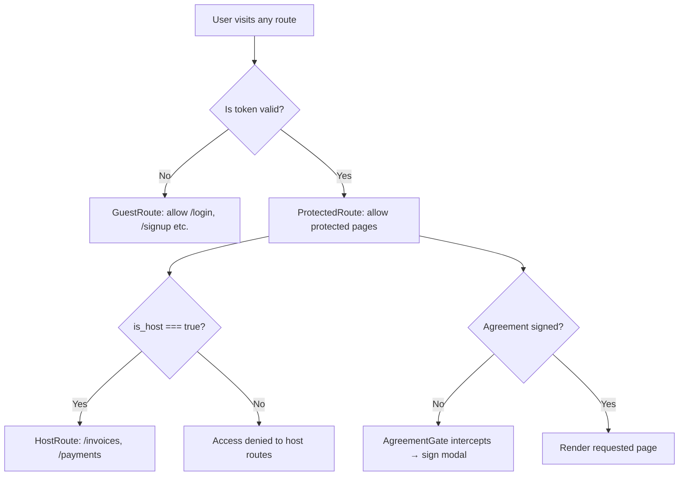
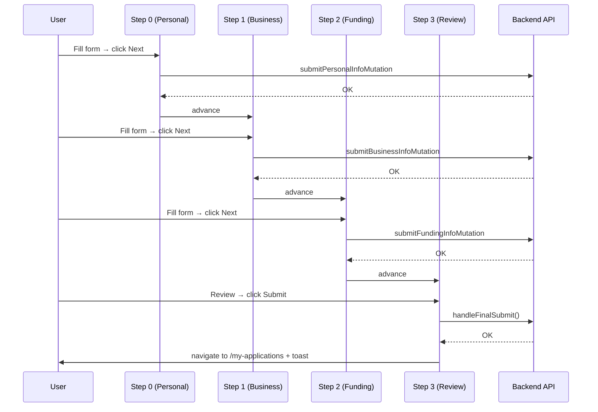
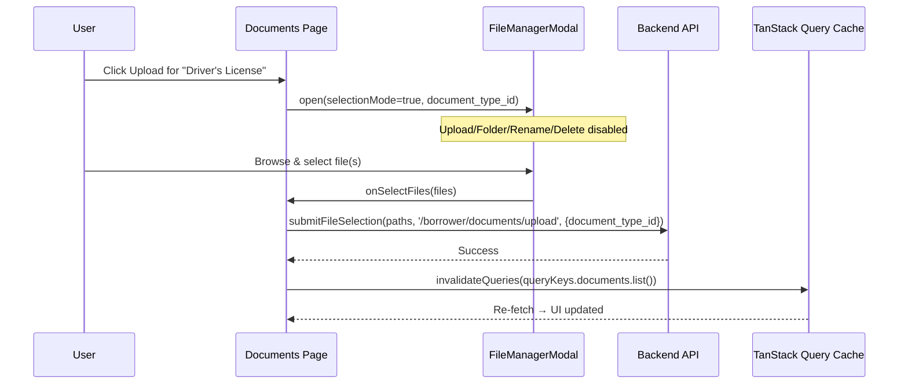

# FCH Borrower Portal — Technical Documentation

> **Version:** 1.0 &nbsp;|&nbsp; **Stack:** React 18 · TypeScript · Vite · TanStack Query · PrimeReact · FullCalendar · Zustand
> **Last Updated:** 2026-04-01 &nbsp;|&nbsp; **Source of Truth:** `src/components/Layout/Sidebar.jsx` and `src/App.jsx`

This document covers every page, module, and shared pattern in the **FCH Borrower Portal**. Sections follow the **Sidebar navigation order**, with additional system-level sections at the end.

---

## Table of Contents

| #   | Section                                                                |
| --- | ---------------------------------------------------------------------- |
| 1   | [Application Overview & Route Map](#1-application-overview--route-map) |
| 2   | [Authentication Pages](#2-authentication-pages)                        |
| 3   | [Dashboard](#3-dashboard)                                              |
| 4   | [Pre-Qualification](#4-pre-qualification)                              |
| 5   | [Fund Application](#5-fund-application)                                |
| 6   | [My Applications](#6-my-applications)                                  |
| 7   | [Invoices](#7-invoices)                                                |
| 8   | [Payments](#8-payments)                                                |
| 9   | [Documents](#9-documents)                                              |
| 10  | [Appointment](#10-appointment)                                         |
| 11  | [Credit Builder](#11-credit-builder)                                   |
| 12  | [Profile](#12-profile)                                                 |
| 13  | [Settings — Change Password](#13-settings--change-password)            |
| 14  | [Agreement Download](#14-agreement-download)                           |
| 15  | [Utility & Error Pages](#15-utility--error-pages)                      |
| 16  | [Layout Components](#16-layout-components)                             |
| 17  | [Shared Architecture Patterns](#17-shared-architecture-patterns)       |

---

## 1. Application Overview & Route Map

### 1.1 Full Route Map

Every route in the application, organized by guard type:

| Route                                | Guard            | Component           | Notes                                 |
| ------------------------------------ | ---------------- | ------------------- | ------------------------------------- |
| `/login`                             | `GuestRoute`     | `SignIn`            | Redirects to `/` if already logged in |
| `/signup`                            | `GuestRoute`     | `SignUp`            |                                       |
| `/forgot-password`                   | `GuestRoute`     | `ForgotPassword`    |                                       |
| `/reset-password`                    | `GuestRoute`     | `ResetPassword`     | Token via URL query string            |
| `/`                                  | `ProtectedRoute` | `Dashboard`         | Default after login                   |
| `/dashboard`                         | `ProtectedRoute` | `Dashboard`         | Alias for `/`                         |
| `/pre-qualification`                 | `ProtectedRoute` | `PreQualification`  |                                       |
| `/fund-application`                  | `ProtectedRoute` | `FundApplication`   |                                       |
| `/my-applications`                   | `ProtectedRoute` | `MyApplication`     |                                       |
| `/documents`                         | `ProtectedRoute` | `Documents`         |                                       |
| `/appointment`                       | `ProtectedRoute` | `Appointments`      |                                       |
| `/profile`                           | `ProtectedRoute` | `Profile`           |                                       |
| `/change-password`                   | `ProtectedRoute` | `ChangePassword`    | Accessible from Header dropdown       |
| `/credit-builder`                    | `ProtectedRoute` | `CreditOverview`    | Index redirect                        |
| `/credit-builder/overview`           | `ProtectedRoute` | `CreditOverview`    |                                       |
| `/credit-builder/guide`              | `ProtectedRoute` | `CreditGuide`       |                                       |
| `/credit-builder/vendor-application` | `ProtectedRoute` | `VendorApplication` |                                       |
| `/credit-builder/progress-tracker`   | `ProtectedRoute` | `ProgressTracker`   |                                       |
| `/credit-builder/resources`          | `ProtectedRoute` | `CreditResources`   |                                       |
| `/invoices`                          | `HostRoute`      | `Invoices`          | Only when `user.is_host === true`     |
| `/payments`                          | `HostRoute`      | `Payments`          | Only when `user.is_host === true`     |
| `/download-agreement/:userId`        | `ProtectedRoute` | `DownloadAgreement` | Opens in new tab                      |
| `/access-denied`                     | `ProtectedRoute` | `ErrorPage` (403)   |                                       |
| `/not-found`                         | `ProtectedRoute` | `ErrorPage` (404)   |                                       |
| `*`                                  | `ProtectedRoute` | `ErrorPage` (404)   | Catch-all                             |

### 1.2 Route Guard Hierarchy



### 1.3 Application Boot Sequence

When the app initializes (`App.jsx` `useEffect` on mount):

1. **`checkSession()`** — Immediately validates the stored token. Clears auth and redirects to `/login` if expired.
2. **`refreshSubscription()`** — Re-fetches user profile + subscription data to ensure plan status is current.
3. **Session polling** — A `setInterval` calls `checkSession()` every **5 minutes** throughout the session and clears on unmount.
4. **`GlobalModals`** — Renders globally inside the layout: handles agreement sign prompt and profile completion warning.

---

## 2. Authentication Pages

> **Location:** `src/pages/singin/` &nbsp;|&nbsp; **Guard:** `GuestRoute` &nbsp;|&nbsp; **Layout:** `Auth` component

All auth pages share the `Auth` layout — a two-column card: form on the left, a branding image (`form-side-image.png`) on the right on large screens.

---

### 2.1 Sign In

| Property    | Value                                                               |
| ----------- | ------------------------------------------------------------------- |
| **File**    | `SignIn.jsx`                                                        |
| **Route**   | `/login`                                                            |
| **Service** | `login(email, password, remember)` from `src/modules/auth/services` |

The primary login gateway for borrowers.

**Functionality:**

- Email/password controlled form with real-time inline validation (field-level `is-invalid` CSS classes).
- On success → JWT/token stored via `authStore` (Zustand) → navigates to `/`.
- On failure → parses Laravel validation shape `{ errors: { email, password }, message }`.
- **Special alert logic:** if the error message contains keywords `expired`, `payment`, `suspended`, or `inactive`, a styled danger alert is shown instead of a standard field error, guiding the user to contact their partner.
- Toggle password visibility (eye icon button).
- "Remember me" checkbox passes a flag to the backend for persistent sessions.
- "Forgot password?" link routes to `/forgot-password`.

**State Reference:**

| State                         | Type      | Purpose                       |
| ----------------------------- | --------- | ----------------------------- |
| `email`, `password`           | `string`  | Controlled input values       |
| `formError`                   | `string`  | General API error             |
| `emailError`, `passwordError` | `string`  | Field-level validation errors |
| `showPassword`                | `boolean` | Toggle password visibility    |
| `loading`                     | `boolean` | Disables form during API call |
| `remember`                    | `boolean` | Persistent session flag       |

---

### 2.2 Sign Up

| Property    | Value                                                        |
| ----------- | ------------------------------------------------------------ |
| **File**    | `SignUp.jsx`                                                 |
| **Route**   | `/signup`                                                    |
| **Service** | `registerBorrower(payload)` from `src/modules/auth/services` |

New borrower registration form. Collects name, email, password, and password confirmation. Redirects to the Dashboard on successful registration.

---

### 2.3 Forgot Password

| Property    | Value                   |
| ----------- | ----------------------- |
| **File**    | `ForgotPassword.jsx`    |
| **Route**   | `/forgot-password`      |
| **Service** | `forgotPassword(email)` |

Single-field form. Accepts an email address and triggers a password reset link via the API. Shows inline success or error feedback.

---

### 2.4 Reset Password

| Property    | Value                                   |
| ----------- | --------------------------------------- |
| **File**    | `ResetPassword.jsx`                     |
| **Route**   | `/reset-password`                       |
| **Service** | `resetPassword(token, email, password)` |

Accepts a new password + confirmation, plus the reset token from the URL query string. Calls the API to complete the password change.

---

## 3. Dashboard

| Property   | Value                                             |
| ---------- | ------------------------------------------------- |
| **File**   | `src/pages/dashboard/Dashboard.jsx`               |
| **Route**  | `/` and `/dashboard`                              |
| **Module** | `src/modules/dashboard` via `useDashboard()` hook |
| **Guard**  | `ProtectedRoute`                                  |

The primary landing page after login — aggregates all key metrics into a single, at-a-glance overview.

### KPI Summary Cards (top row, 4 cards)

| Card                   | Data                                             |
| ---------------------- | ------------------------------------------------ |
| Funding Applications   | Count of all submitted funding applications      |
| Pre-Qualification Apps | Count of all pre-qual submissions                |
| Total Requested Amount | Sum of all requested amounts (formatted in `$K`) |
| Total Funded Amount    | Sum of all approved/funded amounts               |

### Left Column (9/12 on desktop)

- **Credit Score Widget** — PrimeReact `Chart` doughnut. Currently renders as N/A (placeholder), directing users to the Credit Builder. Score data is mocked.
- **Current Tier Status** — Reads `tier.name`, `tier.title`, and `tier.tasks_under_review` from the API response. Shows task count as a badge.
- **Pre-Qualification Applications Table** — PrimeReact `DataTable` with columns: Funding Type, Date, Industry, Business Structure, Requested Amount, Status badge.
- **Recent Funding Applications Table** — Columns: Funding Type, Date, Entity Type, Industry, Requested Amount, Funded Amount, Status badge.

### Right Column (3/12 on desktop)

- **Upcoming Meetings Widget** — Chronological list of the next scheduled meetings. Each entry shows: date, day, time, meeting type badge, and subject. "Schedule Meeting" button links to `/appointment`.
- **Invoices Widget** — Shown only when `invoicesData.length > 0`. Compact table: Invoice ID, Amount, Status badge.
- **Quick Support Card** — CTA card with "Contact Support" → navigates to `/appointment`.

### Subscription Restriction Alert

> [!IMPORTANT]
> If `isRestricted === true` **and** there are unpaid invoices, a full-width danger alert is rendered at the top of the page with a "View & Pay Invoice" button.

**Loading/Error States:**

- Loading → `DashboardLoader` skeleton component.
- Error → Bootstrap danger alert with message.

---

## 4. Pre-Qualification

| Property     | Value                                 |
| ------------ | ------------------------------------- |
| **Location** | `src/pages/prequalification/`         |
| **Route**    | `/pre-qualification`                  |
| **Module**   | `src/modules/pre-qualification`       |
| **Guard**    | `ProtectedRoute` + subscription check |

The initial intake form to pre-screen a borrower before they can submit a full funding application. Uses a **4-step wizard**.

### Step Reference

| Step | Name             | Component             | Data Saved                       |
| ---- | ---------------- | --------------------- | -------------------------------- |
| `0`  | Personal Info    | `PersonalInfoStep`    | `personal`, `business` (partial) |
| `1`  | Business Details | `BusinessDetailsStep` | `business`, `support`            |
| `2`  | Funding Needs    | `FundingNeedsStep`    | `support` (funding preferences)  |
| `3`  | Review & Submit  | `ReviewStep`          | Final submission                 |

### State Management (`usePreQualificationForm` hook)

| State Object | Fields                                                           |
| ------------ | ---------------------------------------------------------------- |
| `personal`   | Full name, email, phone, DOB, last 4 SSN, home address           |
| `business`   | Business name, entity structure, industry type, business address |
| `support`    | Funding purpose, requested amount, monthly revenue               |
| `*Errors`    | Per-step field-level validation error maps                       |

### Step-Save Flow



**Desktop** — Step tabs rendered at top via `StepNavigation`. Content below.
**Mobile** — Each step is an independently collapsible accordion item (`mobileOpenIdx` tracks the open one).

Loading → `TabLoader` skeleton per step. Review step uses a custom skeleton grid.

---

## 5. Fund Application

| Property     | Value                                 |
| ------------ | ------------------------------------- |
| **Location** | `src/pages/fundapplication/`          |
| **Route**    | `/fund-application`                   |
| **Module**   | `src/modules/funding-application`     |
| **Guard**    | `ProtectedRoute` + subscription check |

The most complex page in the portal. An **8-step wizard** that collects all information needed for a formal business funding application.

### Wizard Steps

| Step | Name                  | Key Data Collected                                                         |
| ---- | --------------------- | -------------------------------------------------------------------------- |
| `0`  | Business Information  | Personal info + business address, industry, entity type, years in business |
| `1`  | Ownership Information | Owner name, DOB, SSN, citizenship, ownership %, co-borrowers               |
| `2`  | Financial Information | Monthly/annual revenue, bank name, credit scores, existing debt            |
| `3`  | Funding Request       | Amount, purpose, funding type, timeline, collateral                        |
| `4`  | Document Upload       | Optional file attachments via `FileManagerModal`                           |
| `5`  | Disclosures           | Consent checkboxes: terms, credit check, e-sign, verification, marketing   |
| `6`  | Federal Compliance    | OFAC, PATRIOT Act, FCRA, ECOA; 9 Yes/No legal questions                    |
| `7`  | Attestation           | Final certification checkbox before submit                                 |

### Layout

**Desktop:** Left sidebar (3/12) — step list with numbered/checkmark badges and a progress bar. Right content area (9/12) — active step form.

**Mobile:** Collapsible accordion — only the currently active step is expanded.

### Key Mechanics

**Step Validation & Navigation Lock (`isStepValid`, `maxAllowedIdx`):**

> [!NOTE]
> Users cannot skip ahead until the current step passes validation. Step 4 (Document Upload) is always passable since documents are optional.

**Progress Tracking:**

```
completedCount = number of steps where isStepValid() === true
progressPct    = (completedCount / 8) * 100
```

**Auto-Save on Tab Switch:**
When navigating forward, the system programmatically fires `#btn-save-next`. Each step registers its own save function via `onRegisterSave(fn)`. Ref: `activeStepSaveRef`.

**Co-Borrower System:**

- Managed by `useCoBorrowers` hook.
- Users add/edit/delete co-borrowers from Step 1.
- `CoBorrowerModal` handles the entry form.

**Lazy Data Fetching:**

- `useFundingRequest` → only fetches when `step >= 3`.
- `useFundingApplicationDocuments` → only fetches when `step >= 4`.

---

## 6. My Applications

| Property     | Value                                 |
| ------------ | ------------------------------------- |
| **Location** | `src/pages/myapplication/`            |
| **Route**    | `/my-applications`                    |
| **Module**   | `src/modules/my-application`          |
| **Guard**    | `ProtectedRoute` + subscription check |

A read-only status tracker showing all of the borrower's submitted applications.

### Layout (xl: 8/4 proportions)

**Main Column (order-2 on xl):**

- **`PreQualificationRequests` card** — Lists all pre-qual submissions. Per item: status badge, industry, business structure, funding amount, submission date. Data: `usePreQualificationRequests()`.
- **`FundingApplications` card** — Lists all full applications. Per item: purpose, entity type, requested amount, funded amount, status badge.

**Right Sidebar (order-1 on xl):**

- **`RightSideSection`** — Promotional/guidance widget (tips, next step suggestions, ad placements).

**Mobile:** An additional ad card renders below `xl` breakpoint (`d-xl-none`).

**Page Header:** Persistent "Apply New Prequalification" button (`Link` → `/pre-qualification`).

---

## 7. Invoices

| Property     | Value                                      |
| ------------ | ------------------------------------------ |
| **Location** | `src/pages/invoices/`                      |
| **Route**    | `/invoices`                                |
| **Module**   | `src/modules/invoice`                      |
| **Guard**    | `HostRoute` (`user.is_host === true` only) |

The billing management page for host-tier borrowers.

> [!IMPORTANT]
> This page (and the sidebar link) is **only visible** to users where `user.is_host === true`. Non-host users are redirected by `HostRoute`.

### Functionality

**KPI Stats (InvoiceStats):** Fetched via `fetchInvoiceStats()` — shows paid, unpaid, overdue, and pending totals.

**Two-Phase Filter State:**
Staging state is separate from applied state — API is only called when the user explicitly clicks **Apply**. This prevents excessive requests while the user is still making filter selections.

| Filter           | Control                          |
| ---------------- | -------------------------------- |
| Free text search | Text input (`appliedSearchText`) |
| Status           | Dropdown (`selectedStatus`)      |
| Payee            | Dropdown (`selectedPayee`)       |
| Billing cycle    | Dropdown (`selectedCycle`)       |
| Date range       | Date range picker (`dateRange`)  |

**Invoice Table (InvoiceTable):** PrimeReact `DataTable` with:

- Server-side **pagination** (10 per page default)
- Column **sorting** (default: `created_at DESC`)
- Column-level **filtering**
- Manual **Refresh** button

**State Cascade:** All filter/sort/page changes pass through a single `useEffect` → `loadData()` → also calls `loadStats()` to keep totals consistent.

---

## 8. Payments

| Property     | Value                                      |
| ------------ | ------------------------------------------ |
| **Location** | `src/pages/payments/`                      |
| **Route**    | `/payments`                                |
| **Module**   | `src/modules/payment`                      |
| **Guard**    | `HostRoute` (`user.is_host === true` only) |

Payment history and transaction tracking, following the same pattern as Invoices.

### Functionality

**KPI Stats (PaymentStats):** Aggregated totals (total received, total pending) via `fetchPaymentStats()`.

**Filter Bar (PaymentFilters):** Free-text search, Status dropdown, Date range picker.

**Payment Table (PaymentTable):** PrimeReact `DataTable` with columns:

| Column           | Description                          |
| ---------------- | ------------------------------------ |
| Transaction ID   | Unique payment reference             |
| Invoice ID       | Linked invoice                       |
| From             | Sender name                          |
| Company          | Borrower company                     |
| Payment Type     | Card, ACH, etc.                      |
| Transaction Date | When payment was processed           |
| Amount           | Payment value                        |
| Borrower Name    | Who made the payment                 |
| Status           | Badge (Completed / Pending / Failed) |

Server-side pagination, sorting, and column filtering — same state cascade as Invoices.

---

## 9. Documents

| Property     | Value                                               |
| ------------ | --------------------------------------------------- |
| **Location** | `src/pages/documents/Documents.tsx`                 |
| **Route**    | `/documents`                                        |
| **Modules**  | `src/modules/documents` · `src/modules/filemanager` |
| **Guard**    | `ProtectedRoute` + subscription check               |

The borrower's personal document vault, organized into dynamic categories.

### Functionality

**Document Stats Bar:** `DocumentStats` component shows total file count and total storage size across all categories.

**Section Accordion:** Categories loaded from `useDocumentTypes()` (sorted by `sort_order`). One section open at a time (`openSection` state). Each `DocumentSection` panel shows:

- Uploaded files list (name, preview link, delete button).
- "Upload / Browse" CTA → opens `FileManagerModal` in `selectionMode=true`.

### File Selection Flow



### Delete Flow

1. User clicks delete icon on a file.
2. `DeleteConfirmationModal` appears with the file name for confirmation.
3. On confirm → `deleteDocumentMutation.mutate(documentId)`.
4. On success → toast + document list auto-refreshes.

**Loading:** `DocumentSectionLoader` skeleton shown while both document types and documents APIs are fetching in parallel.

---

## 10. Appointment

| Property     | Value                                    |
| ------------ | ---------------------------------------- |
| **Location** | `src/pages/appointment/Appointments.tsx` |
| **Route**    | `/appointment`                           |
| **Module**   | `src/modules/appointment`                |
| **Guard**    | `ProtectedRoute` + subscription check    |

A full-featured scheduling interface for booking and managing meetings with the firm.

### Layout

| Column             | Contents                                                                   |
| ------------------ | -------------------------------------------------------------------------- |
| Left (3/12 on xl)  | "Create New Appointment" button + scrollable upcoming events list (max 15) |
| Right (9/12 on xl) | Interactive `FullCalendar` component                                       |

### FullCalendar Integration

| Setting                  | Value                                                      |
| ------------------------ | ---------------------------------------------------------- |
| Plugins                  | `dayGrid`, `timeGrid`, `list`, `interaction`, `bootstrap5` |
| View — Desktop (≥1200px) | Month grid                                                 |
| View — Tablet (≥768px)   | Week grid                                                  |
| View — Mobile            | List view                                                  |
| Editable                 | `eventDrop` + `eventResize` enabled                        |

On drag-and-drop or resize → `updateAppointment(id, payload)` is called immediately. Events use a 12-color CSS palette assigned by appointment ID modulo. Special overrides: `red` = cancelled, `green` = completed.

### Appointment Modal (`AppointmentModal`)

Controlled via imperative ref API (`appointmentModalRef`):

| Method            | Trigger                          | Behavior                                              |
| ----------------- | -------------------------------- | ----------------------------------------------------- |
| `create(dateStr)` | Click on empty calendar day      | Opens blank form pre-filled with clicked date         |
| `show(eventId)`   | Click on existing calendar event | Opens form with existing appointment data for editing |

### Upcoming Events List

- Filtered to today + future dates, sorted ascending.
- Past `pending` appointments display as **"Expired"** (computed client-side — not a backend status).
- Each card: color-coded left border, date range, time range, subject, status badge, HTML description (`dangerouslySetInnerHTML`).

**Loading:** Bootstrap `placeholder-glow` skeleton cards for the list; grid skeleton for the calendar.

---

## 11. Credit Builder

| Property       | Value                                 |
| -------------- | ------------------------------------- |
| **Location**   | `src/pages/credit-builder/`           |
| **Base Route** | `/credit-builder`                     |
| **Module**     | `src/modules/credit-builder`          |
| **Guard**      | `ProtectedRoute` + subscription check |

A multi-sub-page module accessible via a collapsible submenu in the sidebar. Helps borrowers build and monitor their business credit profile through a progressive tier system.

### Sub-Page Route Map

| Sub-Page           | Route                                | File                                            |
| ------------------ | ------------------------------------ | ----------------------------------------------- |
| Overview           | `/credit-builder/overview`           | `creditoverview/CreditOverview.tsx`             |
| Step-By-Step Guide | `/credit-builder/guide`              | `creditguide/CreditGuide.tsx`                   |
| Progress Tracker   | `/credit-builder/progress-tracker`   | `creditprogresstracker/ProgressTracker.tsx`     |
| Vendor Application | `/credit-builder/vendor-application` | `creditvendorapplication/VendorApplication.tsx` |
| Resources          | `/credit-builder/resources`          | `creditresources/CreditResources.tsx`           |

---

### 11.1 Credit Builder — Overview

**Route:** `/credit-builder/overview` · **File:** `creditoverview/CreditOverview.tsx`

A bird's-eye view of the borrower's entire credit building journey.

| Component            | Purpose                                                          |
| -------------------- | ---------------------------------------------------------------- |
| `CreditProgress`     | Visual progress bar/chart — overall credit building completion % |
| `TaskStatusCards`    | 4 summary cards: Total Tasks, Completed, Under Review, Locked    |
| `VideoPlayerSection` | Embedded educational videos related to credit building           |

**Bootstrap Tooltips:** On mount, the component manually initializes all `[data-bs-toggle="tooltip"]` elements to support tooltips inside dynamically rendered content.

---

### 11.2 Credit Builder — Step-By-Step Guide

**Route:** `/credit-builder/guide` · **File:** `creditguide/CreditGuide.tsx`

An interactive, tier-gated task checklist for building business credit step by step.

**Data Sources:**

- `useTierTaskList()` → array of Tiers, each with an array of Tasks.
- `useCreditProgress()` → current tier ID, completion %, estimated days, task counts.

**Statistics Bar (`ProgressStats`):** 4 KPI cells — Current Tier, Overall Progress %, Estimated Time to Next Tier, Tasks Completed (e.g., `7/12`).

**Tier Accordion (`TierAccordion`):**

- Only the **current tier** is auto-expanded (`openTier = currentTier.id`).
- Locked tiers (beyond the current) are blocked — clicking one triggers a toast: _"You have to complete [Tier Name] first."_
- Each task shows: title, description, status badge (Pending / Verified / Under Review), and an action button.

**Task Completion:** Clicking a task action opens `TaskCompleteModal` for user confirmation. `handleConfirmCompletion()` logs the task ID (API integration pending).

> [!NOTE]
> If either `useTierTaskList` or `useCreditProgress` fails, a full-page error card is displayed: _"Failed to load credit guide."_

---

### 11.3 Credit Builder — Progress Tracker

**Route:** `/credit-builder/progress-tracker` · **File:** `creditprogresstracker/ProgressTracker.tsx`

A detailed visual dashboard of the borrower's credit score metrics and tier milestone progress.

**Credit Score Cards (3 cards):**

| Bureau                | Score | Range |
| --------------------- | ----- | ----- |
| NAV Business Score    | 75    | 0–100 |
| D&B PAYDEX            | 66    | 0–100 |
| Experian Intelliscore | 73    | 0–100 |

Each card shows per-bureau sub-metrics (e.g., Payment History, Credit Utilization) and a "last updated" indicator.

> [!NOTE]
> Score values are currently **static/mocked**. API integration for live scores is not yet implemented.

**Tier Progression Bar:** A single Bootstrap progress bar showing overall multi-tier progression (Foundation → Tier 1 → Tier 2 → Tier 3 → Tier 4), currently static at 35%.

**Tier Milestone Cards (`vendor-grid`):** One card per tier showing: tier badge, completion %, title, checklist items, and a color-coded status footer (Completed / Active / Pending / Locked).

**Current Tasks Panel:** Filterable task cards (All / Pending / Completed) showing title, description, tier badge, priority badge, and a "Start" button.

---

### 11.4 Credit Builder — Vendor Application

**Route:** `/credit-builder/vendor-application` · **File:** `creditvendorapplication/VendorApplication.tsx`

A directory and application portal for vendor trade line accounts that report to credit bureaus.

**Layout:** Two-column (9/3) — vendor grid on left, activity feed + recommended actions on right.

**Vendor Catalog:** 9 pre-loaded vendor entries. Each vendor card shows:

- Tier badge (0–3), application status (Approved / Pending / Not Applied)
- Category (Office Supplies / Industrial Supplies / Technology)
- Requirements checklist
- Benefits list
- Reporting bureaus (D&B, Experian, Equifax) as color-coded badges

**Filter Bar:** Tier, Category, Reporting Bureau, and text search. Filters are applied client-side in real time.

**Pagination:** Client-side controls (10 / 25 / 50 per page) against a static total of 1,250 (API integration pending).

**Application Flow (per vendor):**

| Button          | Behavior                                                                                   |
| --------------- | ------------------------------------------------------------------------------------------ |
| "Apply Now"     | Opens a modal with two options: go to the vendor's external website OR apply in the portal |
| "Pre-fill Form" | Opens a vendor-specific pre-filled application modal with editable fields                  |

**Right Sidebar:**

- **Recent Activity Timeline** — Color-coded dots with action titles and timestamps.
- **Recommended Actions** — Priority-labelled action cards with "Start Now" buttons.

---

### 11.5 Credit Builder — Resources

**Route:** `/credit-builder/resources` · **File:** `creditresources/CreditResources.tsx`

A curated resource library for building business credit — covering legal registration, services, tools, and tutorials.

**Stats Bar:** 4 KPI cards: Resources (12), Vendor Providers (10), States Covered (50), Quick Links (6).

**Pill Navigation:** Filter tabs scroll the page to the relevant section: All Providers, EIN Registration, State SOS Filing, Business Services, Tools & Forms, Tutorial.

**Content Sections:**

| Section                    | Contents                                                                                                                                                                                                                                   |
| -------------------------- | ------------------------------------------------------------------------------------------------------------------------------------------------------------------------------------------------------------------------------------------ |
| Legal & Registration       | EIN Registration card (IRS, free, 1–2 day) + State SOS Filing card (state selector dropdown)                                                                                                                                               |
| Business Services          | Virtual Office Providers (Regus, Davinci, Alliance) · Business Phone Services (Grasshopper, RingCentral, Google Voice) · 411 Directory Listing (Yellow Pages, White Pages, 411.com, Superpages)                                            |
| Tools & Downloadable Forms | 6 downloadable documents: Business Formation Checklist (PDF), Credit Application Template (DOCX), Financial Projections Spreadsheet (XLSX), Credit Monitoring Log (PDF), Vendor Comparison Worksheet (XLSX), Business Plan Template (DOCX) |
| Video Tutorials            | 6 YouTube-linked videos with thumbnails, durations, and view counts                                                                                                                                                                        |
| Quick Access Tools         | 6 dark-themed quick-link tiles: Manta CSV, Accern Metrics, USPTO Trademarks, Business CSV, EIN Compliance, Vendor Locator                                                                                                                  |

---

## 12. Profile

| Property     | Value                                 |
| ------------ | ------------------------------------- |
| **Location** | `src/pages/profile/profile.tsx`       |
| **Route**    | `/profile`                            |
| **Module**   | `src/modules/profile`                 |
| **Guard**    | `ProtectedRoute` + subscription check |

The borrower's master identity and business record management page. A **3-tab layout** with chevron-style tab buttons.

**URL Deep-Linking:** The active tab can be linked directly via `?tab=0`, `?tab=1`, `?tab=2` query parameters. `useSearchParams()` reads the `tab` param on mount.

### Tab Reference

| Tab | Name             | Component          | Fields                                                                                                                                            |
| --- | ---------------- | ------------------ | ------------------------------------------------------------------------------------------------------------------------------------------------- |
| `0` | Personal Info    | `PersonalInfo`     | First name, Last name, Email, Home address, City, State, Zip, Country, Mobile phone, Home phone, Last 4 SSN, Date of birth                        |
| `1` | Business Details | `BusinessDetails`  | Business name, EIN, Business phone, Business email, DUNS number, Business address, City, State, Country, Zip, Website, Entity type, Industry type |
| `2` | Financial        | `FinancialSupport` | Currency, Years in business, Monthly revenue, Annual revenue                                                                                      |

**State Architecture:**

- Three separate typed state objects (`personal`, `business`, `support`) — each typed via interfaces from `src/modules/profile/types`.
- Each tab component is fully **controlled** — receives its data slice and an `onChange` setter from the parent.
- `onSave` parent callback is a no-op placeholder for future global-level side effects (e.g., analytics tracking).
- Each sub-component has its own independent **Save** button calling the respective API service directly.

---

## 13. Settings — Change Password

| Property     | Value                                                |
| ------------ | ---------------------------------------------------- |
| **Location** | `src/pages/settings/ChangePassword.jsx`              |
| **Route**    | `/change-password`                                   |
| **Module**   | `src/modules/auth-profile` via `useUpdatePassword()` |
| **Access**   | Header dropdown → "Change Password"                  |
| **Guard**    | `ProtectedRoute`                                     |

Account security page allowing the user to update their login password.

### Functionality

**Form Fields:**

- Current Password (required)
- New Password (required, min 8 characters)
- Confirm New Password (required, must match)

**Password Strength Meter:** Rendered live below the "New Password" field when it has any value. Scoring criteria (5 points max):

| Criterion                   | Points |
| --------------------------- | ------ |
| Length ≥ 8 characters       | +1     |
| Length ≥ 12 characters      | +1     |
| Mixed uppercase + lowercase | +1     |
| Contains digit              | +1     |
| Contains special character  | +1     |

Color coding: `0–1` = Danger (red), `2–3` = Warning (yellow), `4–5` = Success (green).

**Validation:** Client-side validation runs before the API call:

- Empty field checks for all three fields.
- Password length minimum enforcement.
- Confirmation match check.

**Submit Flow:**

1. Client-side `validateForm()` → if invalid, sets `errors` object and returns early.
2. `updatePasswordAction(formData)` → TanStack mutation from `useUpdatePassword()`.
3. On success → `toast.success("Password updated successfully!")` → navigate to `/dashboard`.
4. On API error → Laravel field errors parsed into `errors` state.

**Password Requirements Card:** A separate informational card below the form listing the 4 password policy rules with green checkmark icons.

---

## 14. Agreement Download

| Property     | Value                                                                          |
| ------------ | ------------------------------------------------------------------------------ |
| **Location** | `src/pages/agreement/DownloadAgreement.jsx`                                    |
| **Route**    | `/download-agreement/:userId`                                                  |
| **Module**   | `src/modules/agreement` via `fetchSignedAgreementHtml(userId)`                 |
| **Access**   | Header dropdown → "My Agreement" (only if `user.is_agreement_signed === true`) |
| **Guard**    | `ProtectedRoute`                                                               |
| **Opens In** | New browser tab (`target="_blank"`)                                            |

A read-only agreement viewer that renders the borrower's signed agreement as a formatted print-ready page.

### Functionality

**On Mount:**

1. Reads `:userId` from URL params. Routes to `/not-found` if missing.
2. Calls `fetchSignedAgreementHtml(userId)` to retrieve the agreement's HTML content.
3. If no HTML content returned → redirects to `/not-found`.
4. The HTML is post-processed before rendering:
   - Injects custom `<style>` overrides (removes card borders, normalizes signature fields).
   - Injects a `<script>` block that: strips asterisks from labels, converts `<input>` / `<textarea>` / `<select>` elements into plain `<span>` text (for print fidelity), and clears signature box styling.
5. Post-processed HTML is written into a sandboxed `<iframe>` via `document.open() / write() / close()`.
6. iframe height is auto-adjusted at 300ms, 800ms, and 2000ms intervals (to account for font/image load delays).

**Toolbar:**

- "VERIFIED AGREEMENT" badge with shield icon.
- "Print or Download PDF" button → calls `iframeRef.current.contentWindow.print()`.

**Loading State:** Centered Bootstrap spinner while the API call completes.

---

## 15. Utility & Error Pages

| Route            | Component   | Status Code     |
| ---------------- | ----------- | --------------- |
| `/access-denied` | `ErrorPage` | 403 — Forbidden |
| `/not-found`     | `ErrorPage` | 404 — Not Found |
| `*` (catch-all)  | `ErrorPage` | 404 — Not Found |

`ErrorPage` accepts a `status` prop (403 or 404) and renders an appropriate illustration and message. Used for both unauthorized access and missing route scenarios.

---

## 16. Layout Components

### 16.1 Header

**File:** `src/components/Layout/Header.jsx`

The persistent top navigation bar rendered inside every protected page.

**Features:**

- **Logo** — Links to `/`. Shows full logo (`logo.png`) at `lg` size, favicon at `sm` size.
- **Sidebar Toggle Button** — Hamburger/chevron button that:
  - On mobile (`< 768px`) → toggles `vertical-sidebar-enable` class on `<body>`.
  - On desktop → toggles `data-sidebar-size` attribute on `<html>` between `lg` and `sm`. Persisted to `sessionStorage`.
- **User Dropdown** — Bottom-right avatar button shows user's name and role. Dropdown contains:
  - **Change Password** → navigates to `/change-password`.
  - **My Agreement** → renders `Link` to `/download-agreement/:userId` (target blank) — shown only if `user.is_agreement_signed === true`.
  - **Logout** → calls `logout()` API + `clearAuth()` + navigates to `/login`.

> [!NOTE]
> Search bar and notification bell are commented out (`//`) in the current version and not active.

### 16.2 Sidebar

**File:** `src/components/Layout/Sidebar.jsx`

The primary navigation panel defining the application's menu structure. Links use React Router's `NavLink` (active class applied automatically).

**Subscription Restriction:** Each navigation link receives a `restricted={isRestricted}` prop. When restricted, clicking a link:

- Calls `e.preventDefault()` to block the route change.
- Shows a lock icon (`🔒`) next to the label.
- (Typically) shows a toast or alert directing the user to resolve their subscription.

**Credit Builder Submenu:** Collapsible child menu with 5 sub-links: Overview, Step-By-Step Guide, Vendor Application, Progress Tracker, Resources.

### 16.3 GlobalModals

**File:** `src/components/Common/Modals/GlobalModals`

Renders globally inside the main layout wrapper alongside every protected page. Manages:

- **Agreement Sign Modal** (`AgreementSignModal`) — Intercepts the user if `checkAgreementSign()` returns a pending agreement. Forces signature before the user can proceed to any page.
- **Profile Completion Modal** (`ProfileCompleteCheckModal`) — Prompts the user to complete their profile if `fetchProfileCompletion()` returns a low completion percentage or missing required fields.

---

## 17. Shared Architecture Patterns

### 17.1 Module Layer Architecture

All domain modules under `src/modules/` follow a consistent 4-layer structure:

```
src/modules/<module>/
├── services.ts    →  Pure async API functions (Axios via apiClient). No React hooks.
├── queries.ts     →  TanStack Query v5 wrappers (useQuery, useMutation)
├── types.ts       →  TypeScript interfaces for request/response payloads
└── index.ts       →  Barrel re-exports for clean page-level imports
```

### Layer Responsibilities

| Layer         | Technology          | Responsibilities                                                                |
| ------------- | ------------------- | ------------------------------------------------------------------------------- |
| `services.ts` | Axios (`apiClient`) | HTTP calls only. Stateless. No hooks. Returns raw `AxiosResponse`.              |
| `queries.ts`  | TanStack Query v5   | Caching, background re-fetching, `isLoading`/`isError` state for components     |
| `types.ts`    | TypeScript          | Type-safe `Request` / `Response` interfaces shared across service and UI layers |
| `index.ts`    | ES Modules          | Single import point: `import { useXyz } from '../modules/xyz'`                  |

### 17.2 Global State — Zustand Auth Store

**Path:** `src/store/auth`

The `authStore` holds the **single source of truth** for the authenticated user's session:

| Field              | Type           | Contents                                                               |
| ------------------ | -------------- | ---------------------------------------------------------------------- |
| `user`             | `User`         | `name`, `email`, `role`, `is_host`, `entity_id`, `is_agreement_signed` |
| `userSubscription` | `Subscription` | Plan name, status, expiry date                                         |

Key utility: `isSubscriptionRestricted(userSubscription)` — evaluated per-page and per-link in the Sidebar to conditionally lock features and display lock icons.

### 17.3 File Manager Modal — Dual-Mode Component

**Path:** `src/components/FileManagerModal/FileManagerModal`

A shared modal used across **Documents** (`/documents`) and **Fund Application** (`/fund-application`) with two distinct operating modes:

| Prop                                | Mode            | Behavior                                                   |
| ----------------------------------- | --------------- | ---------------------------------------------------------- |
| `selectionMode={false}` _(default)_ | Management Mode | Full CRUD: upload, create folder, rename, delete, download |
| `selectionMode={true}`              | Selection Mode  | Read-only picker: browse and select files only             |

**Selection Mode restrictions** (UI elements hidden/disabled):

- ❌ Upload button hidden
- ❌ New Folder button hidden
- ❌ Right-click context menu disabled
- ❌ Rename / Delete options disabled
- ✅ Browse, multi-select (Ctrl+Click), and confirm selection

When selection is confirmed → `onSelectFiles(files: FileSystemItem[])` callback is invoked.

**Additional Props Used in Production:**

| Prop         | Type               | Description                                    |
| ------------ | ------------------ | ---------------------------------------------- |
| `section`    | `string`           | Scopes file browser to a named media section   |
| `entityType` | `string`           | e.g., `"borrowers"` — entity scope for the API |
| `entityId`   | `number \| string` | The authenticated user's `entity_id`           |

### 17.4 Subscription Restriction Pattern

```javascript
// In Sidebar — per-link restriction flag
<LinkItem
  to="/pre-qualification"
  label="Pre Qualification"
  restricted={isRestricted}
/>

// LinkItem behavior when restricted:
// e.preventDefault() blocks navigation
// 🔒 lock icon rendered next to label
```

Protected pages also check `isRestricted` internally and may render a locked/empty state or redirect to an upgrade prompt.

### 17.5 Skeleton Loading Strategy

Each major page uses a dedicated skeleton component to show structure before data loads:

| Skeleton                     | Used In                                            |
| ---------------------------- | -------------------------------------------------- |
| `DashboardLoader`            | Dashboard page                                     |
| `TabLoader`                  | Pre-Qualification and Fund Application wizard tabs |
| `DocumentSectionLoader`      | Documents accordion categories                     |
| `TierTaskListLoader`         | Credit Builder — Guide tier list                   |
| Bootstrap `placeholder-glow` | Appointment upcoming list + calendar grid          |

### 17.6 Toast Notification System

**Library:** `react-toastify` — configured globally in `App.jsx`:

```jsx
<ToastContainer position="top-right" autoClose={3000} />
```

All async operations (form submits, file uploads, deletions) produce `toast.success()` or `toast.error()` feedback. Import: `import { toast } from 'react-toastify'`.

### 17.7 HTTP Client

**Path:** `src/lib/http/`

All API calls go through a central Axios instance (`apiClient`) configured inside this directory. Benefits include:

- Centralized base URL configuration.
- Auth token injection via request interceptors.
- Automatic token expiry handling via response interceptors (redirects to `/login` on 401).

### 17.8 Stripe Integration

**Path:** `src/lib/stripe.ts`

Used by the **Payment** module for secure card tokenization. The `processInvoicePayment(payload)` service calls this library to tokenize card data before submitting to the backend, ensuring raw card numbers never pass through application code.
